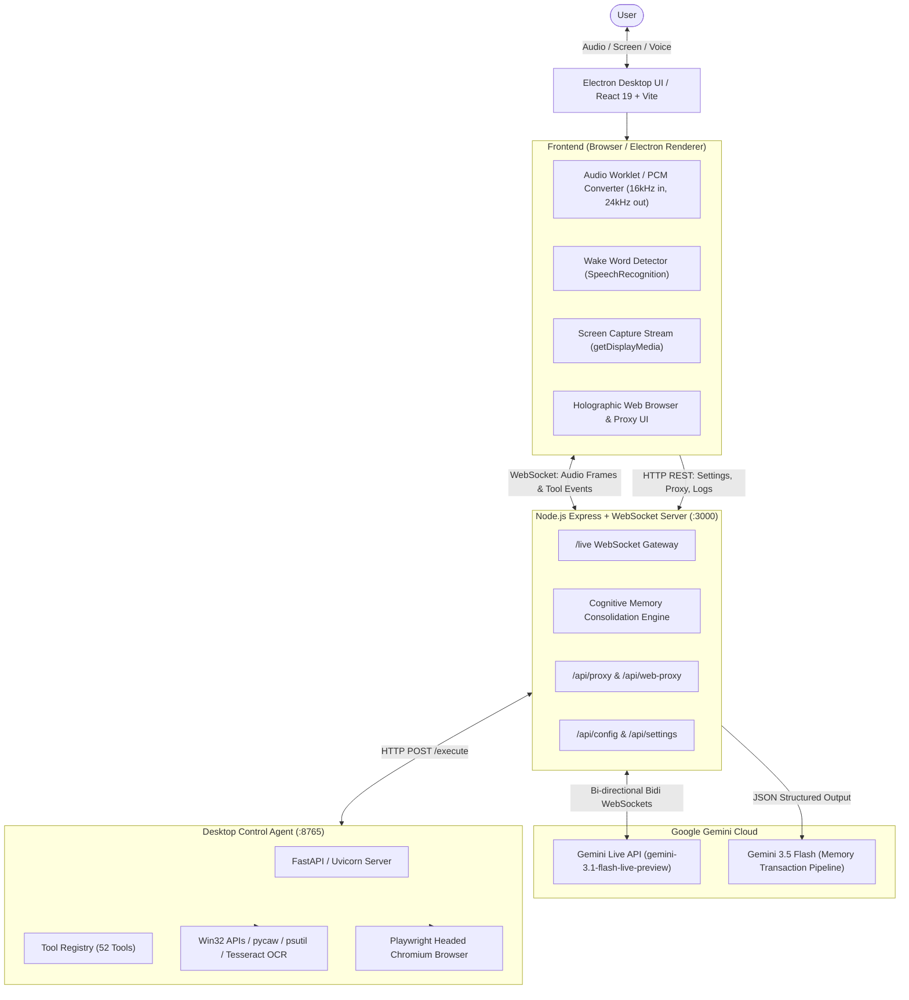

# 🛡️ MYRAA AI Assistant — Comprehensive Architectural & Security Audit Report

> **Project Name:** MYRAA AI Desktop Assistant  
> **Repository:** `d:\myraa\MYRAA_\myraa-ai-assistant`  
> **Report Date:** November 4, 2026  
> **Classification:** Full System Audit & Architecture Guide (How, What, Why, Vulnerabilities & Fixes)

---

## 📑 Table of Contents
1. [Executive Summary](#1-executive-summary)
2. [What is MYRAA? (Core Capabilities & Features)](#2-what-is-myraa-core-capabilities--features)
3. [How it Works (System Architecture & Data Flows)](#3-how-it-works-system-architecture--data-flows)
4. [Why it Works (Engineering Rationale & Technologies)](#4-why-it-works-engineering-rationale--technologies)
5. [In-Depth File-by-File Analysis](#5-in-depth-file-by-file-analysis)
6. [Security Audit & Vulnerability Assessment](#6-security-audit--vulnerability-assessment)
7. [Dependency & Package Vulnerabilities](#7-dependency--package-vulnerabilities)
8. [Actionable Remediation & Hardening Plan](#8-actionable-remediation--hardening-plan)

---

## 1. Executive Summary

**MYRAA** is a multimodal, real-time desktop AI companion designed to act as an autonomous anime-heroine companion and JARVIS-class PC automation assistant. 

It blends:
- **Low-latency bidirectional voice & screen vision** powered by the **Google Gemini Live API (`gemini-3.1-flash-live-preview`)**.
- **A 52-tool Windows OS desktop automation agent** powered by a **Python FastAPI / Uvicorn** background service (`desktop_agent`).
- **An autonomous browser automation subsystem** running **Playwright Chromium** instances alongside an in-app holographic browser.
- **A persistent cognitive memory engine** that extracts durable facts using **Gemini 3.5 Flash** and dynamically synthesizes system instructions.
- **An Electron desktop application shell** running on Windows.

While the architecture demonstrates strong integration of modern generative AI streaming, our security analysis identified **several critical vulnerabilities** (including live hardcoded API keys, unauthenticated CORS RCE on localhost, UXSS / Origin Confusion in the web proxy, and bypassable confirmation controls) that must be mitigated before distribution.

---

## 2. What is MYRAA? (Core Capabilities & Features)

| Feature Pillar | Description |
| :--- | :--- |
| **Multimodal Real-Time Voice** | Full-duplex conversational voice using 16kHz PCM microphone input, 24kHz raw PCM audio streaming back from Gemini, and Aoede voice persona. |
| **Real-Time Screen Vision** | Captures the user's active screen/window at regular intervals, encodes frames to JPEG, and streams them into Gemini Live for real-time visual comprehension, debugging, and UI analysis. |
| **Always-Listening Wake Word** | Continuous background listener using the Web Speech API (`webkitSpeechRecognition`) for hands-free triggering of `"Myraa"`. |
| **JARVIS Desktop OS Control** | 52 tools executing Windows native tasks: opening/closing apps, file creation/editing/searching, volume/brightness control, window snapping, clipboard read/write, OCR screen-reading, and Python script execution. |
| **Autonomous Web Browsing** | Automated Chromium browser control via Playwright (navigation, search, form fills, clicks, scrolling) plus an in-app HTML proxy for embedding web pages directly in the UI. |
| **Long-Term Memory Core** | Background consolidation loop that tracks dialogue, extracts key personal facts (identity, goals, preferences, projects), and persists them to `memories.json`. |
| **Desktop Shell Packaging** | Packaged as a native Windows `.exe` using Electron with a custom splash screen, single-instance mutex, and background service lifecycle management. |

---

## 3. How it Works (System Architecture & Data Flows)

### 3.1 High-Level Architecture Diagram



---

### 3.2 Data Flow 1: Live Voice & Multimodal Screen Vision
1. **User Speaks**: Microphone audio is captured via `navigator.mediaDevices.getUserMedia()`.
2. **Audio Processing**: `src/lib/audio.ts` downsamples to 16,000 Hz, converts Float32 to Signed 16-bit PCM Little-Endian, and base64-encodes the bytes into `{ realtimeInput: { mediaChunks: [{ mimeType: "audio/pcm", data }] } }`.
3. **Screen Capture**: If Screen Sharing is active, `captureFrameAndSend()` in `src/App.tsx` draws the active video frame to an off-screen canvas, encodes it as JPEG at 0.6 quality, and sends it over the WebSocket.
4. **WebSocket Bridge**: `server.ts` routes the payload directly into the active Gemini Live session (`session.send()`).
5. **Model Response**: Gemini responds with 24,000 Hz PCM audio chunks. `server.ts` forwards these to the frontend client WebSocket, which queues and plays them gaplessly via the Web Audio API `AudioContext`.

---

### 3.3 Data Flow 2: Desktop Automation & Tool Execution
1. **Tool Invocation**: Gemini decides an OS action is needed (e.g. `openApplication`, `runPythonScript`, `takeScreenshot`, `createFile`).
2. **Server Routing**: `server.ts` intercepts the `toolCall` from the Gemini Live stream. If the tool is in `DESKTOP_TOOLS`, it forwards an HTTP request:
   ```http
   POST http://127.0.0.1:8765/execute
   Content-Type: application/json

   { "tool": "createFile", "args": { "path": "Desktop/notes.txt", "content": "..." } }
   ```
3. **Python Execution**: FastAPI (`desktop_agent/main.py`) receives the call, locates the handler in `registry.py`, executes it against the Windows OS (via `pywin32`, `pycaw`, `psutil`, or `subprocess`), and returns the JSON result.
4. **Model Feed**: `server.ts` packages the output into a `session.sendToolResponse()` function response back to Gemini, allowing Myraa to verbally confirm completion to the user.

---

### 3.4 Data Flow 3: Cognitive Memory Lifecycle
1. **Transcription Accumulation**: Every utterance from the user and Myraa is collected in `dialogueHistory`.
2. **Consolidation Trigger**: Once the slice reaches sufficient length, `processConversationSlice()` in `server_memory.ts` sends the conversation to `gemini-3.5-flash`.
3. **Structured Transactions**: Gemini outputs structured JSON transactions (`ADD`, `UPDATE`, `REMOVE`) categorizing facts into *identity*, *preference*, *goal*, *project*, *relationship*, *emotional*, and *behavior*.
4. **System Instruction Injection**: On the next WebSocket connection, `formatSystemInstructionsWithMemories()` loads `memories.json` and embeds the user knowledge card directly into the model's base system prompt.

---

## 4. Why it Works (Engineering Rationale & Technologies)

- **Why Gemini Live API instead of standard REST?** Standard chat completion APIs require completing an entire phrase before synthesis begins, adding 2–5 seconds of latency. Gemini Live API operates over full-duplex WebSockets with streaming audio input and output, achieving natural sub-second voice interruption and conversational flow.
- **Why a Separate Python Service for Desktop Control?** Node.js lacks direct, ergonomic access to native Windows COM interfaces, WMI, Windows UI Automation, and ctypes without brittle native C++ addons (`node-gyp`). Python provides robust, battle-tested libraries (`pywin32`, `pycaw`, `psutil`, `pyautogui`, `pytesseract`) that run reliably on Windows.
- **Why Playwright over Selenium or Puppeteer?** Playwright supports modern async event loops, auto-waiting for DOM selectors, persistent browser contexts, and seamless control of multi-tab sessions with minimal overhead.
- **Why Electron with `ELECTRON_RUN_AS_NODE`?** When bundled with PyInstaller and Electron Builder, the application does not require the end user to pre-install Node.js or Python; the app executes using Electron's embedded Node runtime and the frozen Python executable.

---

## 5. In-Depth File-by-File Analysis

### Core Server & Services
- **`server.ts` (78.5 KB)**: The central orchestration server. Starts Express, attaches the `/live` WebSocket server, connects to Google Gemini Live API, registers all 52 Gemini tool schemas, hosts scraper and web-proxy endpoints, serves static frontend assets, and auto-spawns the Python desktop agent.
- **`server_memory.ts` (9.6 KB)**: Manages persistent episodic memory. Handles loading/saving `memories.json`, formatting system instruction memory cards, and executing asynchronous memory consolidation using `gemini-3.5-flash`.
- **`server_paths.ts` (2.9 KB)**: Resolves user data paths (`%APPDATA%/MYRAA` in production vs. workspace root in development) and reads/writes `secrets.json`.
- **`local-agent.js` (13 KB)**: Alternative/legacy standalone Express server on port 3001 exposing Playwright browser automation via REST APIs with open CORS.

### Python Desktop Agent (`desktop_agent/`)
- **`main.py`**: FastAPI application listening on `127.0.0.1:8765`. Exposes `/health`, `/tools`, and `/execute`.
- **`registry.py`**: Decorator-based tool registry (`@register`), global state cache, and custom `ToolError` definitions.
- **`tools_applications.py`**: Launches and terminates Windows applications (Notepad, Chrome, VS Code, Calculator, Settings, etc.) via `subprocess.Popen` and `taskkill`.
- **`tools_browser.py`**: Dedicated async Playwright Chromium controller running on an independent background thread and event loop.
- **`tools_clipboard.py`**: Sends virtual `Ctrl+C` / `Ctrl+V` keystrokes and reads/writes clipboard text via `pyperclip` and `ctypes`.
- **`tools_coding.py`**: Generates project structures, writes code files, and executes Python scripts (`runPythonScript`) using auto-detected local Python interpreters.
- **`tools_confirmation.py`**: Two-step confirmation system for destructive actions (shutdown, restart, sleep, lock) using single-use 60-second tokens.
- **`tools_files.py`**: File operations (create, read, rename, delete via Recycle Bin `send2trash`, list, search) with path resolution and `SAFE_ROOTS` restrictions.
- **`tools_pc.py`**: Master volume control via `pycaw`/`comtypes` or media keys; screen brightness via WMI/PowerShell; power management via `shutdown.exe` and `powrprof.dll`.
- **`tools_screenshot.py`**: Full-screen and active-window capture using Pillow `ImageGrab`, base64 encoding, and OCR extraction via `pytesseract`.
- **`tools_startup.py`**: Configures Windows auto-start on boot via HKCU registry key `Software\Microsoft\Windows\CurrentVersion\Run`.
- **`tools_system.py`**: Hardware metrics inspection (CPU percent, RAM, disk mounts, uptime) via `psutil` and NVIDIA GPU metrics via `nvidia-ml-py3`.
- **`tools_websites.py` & `tools_search.py`**: Launches default web browsers to search queries or predefined URL aliases.
- **`tools_windows.py`**: Window state management (minimize, maximize, close, switch) using `pywin32` / `win32gui`.

### Frontend Components (`src/`)
- **`App.tsx` (42 KB)**: Main UI shell. Manages live audio session, WebSocket lifecycle, screen-sharing capture loop, tool event routing, and state visualizers.
- **`components/BrowserAgent.tsx` (62 KB)**: Holographic web browser component. Manages tabs, iframe navigation, proxy routing, YouTube media player controls, and automation logging.
- **`components/MyraaCoreVisualizer.tsx`**: Dynamic 2D canvas particle visualizer representing Myraa's emotional states (idle, listening, thinking, speaking) reacting to audio frequencies.
- **`components/MemoryDashboard.tsx`**: Modal interface allowing users to view, search, add, edit, and delete memories persisted in `memories.json`.
- **`components/SettingsPanel.tsx`**: Configuration panel for Gemini API key, microphone device selection, wake word toggle, auto-start, and system diagnostics.
- **`lib/audio.ts` (15 KB)**: Web Audio API pipeline. AudioContext, double-buffered Float32 to Int16 PCM conversion, 16kHz input streaming, and 24kHz model playback.
- **`lib/wakeWord.ts`**: Speech recognition listener with automatic error recovery and debounce filtering.

---

## 6. Security Audit & Vulnerability Assessment

### 🚨 Vulnerability Summary Matrix

| ID | Title | Severity | Impact | Location |
| :--- | :--- | :--- | :--- | :--- |
| **VULN-01** | **Live Gemini API Key Committed in `.env`** | **CRITICAL** | Credential Theft & Unauthorized API Quota Consumption | `.env` |
| **VULN-02** | **Unauthenticated Local RCE via Desktop Agent CORS** | **CRITICAL** | Full Remote Code Execution & PC Takeover from Web | `desktop_agent/main.py:64-70` |
| **VULN-03** | **Universal Cross-Site Scripting (UXSS) / Origin Confusion via Web Proxy** | **CRITICAL** | App Takeover, Key Theft & Arbitrary Action Execution | `server.ts:520-650`, `BrowserAgent.tsx:1049` |
| **VULN-04** | **Bypassable Power Action Confirmation Flow** | **HIGH** | Arbitrary Remote Shutdown / Restart without User Confirmation | `tools_confirmation.py`, `tools_pc.py` |
| **VULN-05** | **Path Traversal & Safe Root Boundary Escape** | **HIGH** | Arbitrary File Read / Write across Entire User Directory | `tools_files.py:28-89`, `tools_coding.py` |
| **VULN-06** | **Unauthenticated WebSocket & API Endpoints on Localhost** | **HIGH** | Unauthorized Session Hijacking & Memory Tampering | `server.ts:250-380`, `server.ts:756` |
| **VULN-07** | **Server-Side Request Forgery (SSRF) in Scraper & Web Proxy** | **HIGH** | Internal Network Scanning & Cloud Metadata Access | `server.ts:431`, `server.ts:521` |
| **VULN-08** | **Plaintext Secret Storage on Disk** | **MEDIUM** | Credential Exposure to Local Malicious Software | `server_paths.ts:36-81` |
| **VULN-09** | **Hardcoded Machine-Specific User Paths** | **MEDIUM** | Portability Failure on Other Windows Systems | `start-myraa.bat`, `tools_coding.py` |
| **VULN-10** | **Chromium Launched with `--no-sandbox`** | **MEDIUM** | Sandbox Escape if Exploited by Browser Zero-Day | `tools_browser.py:79`, `local-agent.js:52` |

---

### Detailed Findings & Technical Impact

#### 🔴 VULN-01: Live Gemini API Key Committed in `.env`
- **Location:** `.env` (Lines 1–3)
- **Detail:** An active Google Gemini API key (`<REDACTED_SAMPLE_KEY>`) is stored in plaintext in the project root file `.env`.
- **Risk:** Anyone with access to the repo or local directory can use this key to run high-volume API requests, consume billing quotas, or access linked Gemini resources.
- **Immediate Action:** **Revoke this key immediately** in Google AI Studio and replace it with a newly generated key stored in the secure user settings store.

#### 🔴 VULN-02: Unauthenticated Local RCE via Desktop Agent CORS
- **Location:** `desktop_agent/main.py` lines 64–70 & line 101:
  ```python
  app.add_middleware(
      CORSMiddleware,
      allow_origins=["*"],
      allow_credentials=False,
      allow_methods=["*"],
      allow_headers=["*"],
  )
  ```
- **Detail:** The desktop agent listens on `127.0.0.1:8765` and permits cross-origin requests from **ANY origin (`*`)** without any authentication header, pre-shared token, or Origin validation.
- **Exploitation Scenario:** If a user visits ANY website on the internet using Chrome, Edge, or Firefox while MYRAA is running, the malicious site's JavaScript can issue a background `fetch("http://127.0.0.1:8765/execute", { method: "POST", body: JSON.stringify({ tool: "runPythonScript", args: { ... } }) })` and **execute arbitrary commands on the victim's PC with the privileges of the logged-in user!**

#### 🔴 VULN-03: Universal Cross-Site Scripting (UXSS) / Origin Confusion via Web Proxy
- **Location:** `server.ts` lines 521–650 and `src/components/BrowserAgent.tsx` line 1049
- **Detail:** `/api/web-proxy` fetches untrusted external web pages, strips their `Content-Security-Policy` and `X-Frame-Options` headers, injects an interceptor script, and serves the external HTML under `http://localhost:3000`. In `BrowserAgent.tsx`, the iframe is embedded **without a `sandbox` attribute** on the exact same origin (`http://localhost:3000`).
- **Exploitation Scenario:** A malicious website browsed within Myraa's web browser can access `window.parent`, read `localStorage`, make requests to `http://localhost:3000/api/config/apikey`, or connect to `ws://localhost:3000/live` to trigger any tool in the assistant!

#### 🟠 VULN-04: Bypassable Power Action Confirmation Flow
- **Location:** `desktop_agent/tools_confirmation.py` lines 42–73 & `desktop_agent/tools_pc.py` line 219
- **Detail:** When `requestPowerAction` is called, the confirmation token is returned directly in the API response:
  ```json
  { "requires_confirmation": true, "token": "aBc123XyZ", ... }
  ```
  The server does not display a native modal or require user PIN/click input before accepting `executePowerAction(token)`.
- **Exploitation Scenario:** Any automated script, prompt injection, or caller can immediately read the returned token and immediately invoke `executePowerAction`, shutting down or rebooting the PC without the user ever being asked.

#### 🟠 VULN-05: Path Traversal & Safe Root Boundary Escape
- **Location:** `desktop_agent/tools_files.py` lines 28–37 & lines 73–89
- **Detail:** `SAFE_ROOTS` includes `HOME` (`C:\Users\<User>`). Any file in the user directory (e.g. `C:\Users\<User>\.ssh\id_rsa`, `C:\Users\<User>\.aws\credentials`, browser profiles, AppData) is permitted. Furthermore, passing `allow_anywhere=True` completely bypasses the check, allowing reads and writes to `C:\Windows` or startup directories.

#### 🟠 VULN-06 & VULN-07: Unauthenticated Localhost Endpoints & SSRF
- **Location:** `server.ts` (`/api/proxy`, `/api/web-proxy`, `/api/memories`, `/api/settings`)
- **Detail:** No authentication or CSRF tokens protect the Express REST endpoints or WebSocket. `/api/proxy?url=...` allows arbitrary requests to internal subnets (`http://192.168.1.1`, `http://10.0.0.1`, `http://169.254.169.254`).

#### 🟡 VULN-08 to VULN-10: Plaintext Storage, Hardcoded Paths & `--no-sandbox`
- `secrets.json` stores the user's API key unencrypted on disk.
- Batch files and Python scripts contain hardcoded paths like `C:\Users\MSI\AppData\Local\...` which break when executed on a different user account or drive.
- Playwright is started with `--no-sandbox`, eliminating process isolation in Chromium.

---

## 7. Dependency & Package Vulnerabilities

Running `npm audit` on the existing `package-lock.json` reveals **33 vulnerabilities (1 Critical, 13 High, 18 Moderate, 1 Low)**:
- **`proxy-addr` (Critical)**: Vulnerable to IP spoofing via IPv4-mapped IPv6 trust subnets (GHSA-jqcg-44mw-7w3h).
- **`vite` <= 6.4.3 (High)**: Cross-origin script execution via custom middleware and Windows `%` command escaping flaws in `launch-editor`.
- **`body-parser` (High)**: Denial of Service via trailing bytes in compressed request bodies.
- **`undici` (High)**: Multiple Denial of Service and CRLF / header injection advisories.
- **`brace-expansion` (High)**: Uncontrolled recursion and heap exhaustion leading to process termination.

---

## 8. Actionable Remediation & Hardening Plan

### Step 1: Immediate Credential Security
1. Revoke the exposed API key in Google AI Studio console immediately.
2. Remove `.env` containing keys from disk and git history.
3. Keep `.env.example` as a template with placeholder values only.

### Step 2: Lock Down Desktop Agent CORS & Authentication
In `desktop_agent/main.py`:
- Restrict `allow_origins` strictly to `["http://localhost:3000", "http://127.0.0.1:3000"]`.
- Implement a shared session secret / bearer token generated by `server.ts` on startup and passed in `Authorization: Bearer <token>` for all `/execute` requests. Any request without the token must return `401 Unauthorized`.

### Step 3: Secure the Web Proxy and Sandbox Iframes
In `src/components/BrowserAgent.tsx`:
- Add `sandbox="allow-scripts allow-forms"` to the proxy `<iframe>` and ensure `allow-same-origin` is **omitted** so the external site runs in a unique, untrusted origin and cannot access parent window DOM, cookies, or APIs.
- In `server.ts`, restrict `/api/proxy` and `/api/web-proxy` to reject loopback/private IP addresses (`127.0.0.1`, `localhost`, `10.*`, `192.168.*`, `169.254.*`) to eliminate SSRF.

### Step 4: Hardware / Physical Confirmation for Power Actions
In `desktop_agent/tools_confirmation.py`:
- Do NOT return the token in the API response.
- Require an explicit user interaction (e.g. native Windows notification dialog / Electron confirmation box) before marking the action confirmed.

### Step 5: Fix Hardcoded Paths
In `start-myraa.bat` and `desktop_agent/tools_coding.py`:
- Use `python.exe` resolved from `%PATH%` or relative virtual environments instead of `C:\Users\MSI\...`.

### Step 6: Patch Dependencies
Run:
```bash
npm audit fix
```
Update Vite, Express, and Electron to their latest stable releases to eliminate known vulnerabilities.
